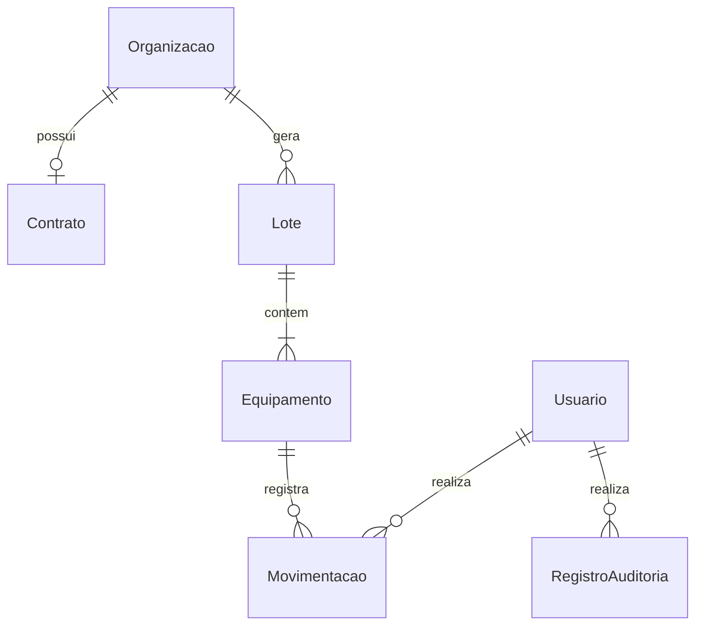

# Arquitetura KISS

## Um processo e um banco

```text
Cliente HTTP (Swagger, REST Client, Postman)
          |
          v
Fastify: schemas, JWT e erros
          |
          v
modules/*/routes.ts    traduz HTTP para comandos
          |
          v
modules/*/service.ts   regras, autorização e transações
          |
          v
Prisma Client → PostgreSQL
```

O Prisma cumpre o papel concreto de persistência sugerido na AV2. Não criamos um BaseRepository nem wrappers que só repassam CRUD, porque não há outra implementação de banco para trocar. Os módulos recebem o Prisma como dependência e não recebem objetos HTTP.

## Estrutura

```text
src/
  app.ts              composição sem abrir porta; útil para testes
  server.ts           processo, porta e encerramento
  config.ts           configuração validada
  database.ts         Prisma e adapter PostgreSQL
  plugins/auth.ts     token, conta ativa e revogação
  modules/
    auth/             login, conta atual, senha e logout
    organizations/    organizações e validação de CNPJ
    contracts/        contrato e renovação
    lots/             recebimento, complemento e status agregado
    equipment/        rastreabilidade e movimentação
    users/            administração de contas
    settings/         parâmetros financeiros
    reports/          consultas e estimativa financeira
    audit/            consulta de alterações
  shared/             erros, papéis, datas, schemas e gravação da auditoria
prisma/
  schema.prisma
  migrations/         SQL, incluindo checks e triggers
  seed.ts
test/http.test.ts     integração pela interface HTTP
```

Movimentações pertencem ao módulo de equipamentos: alterar o estado e gravar o histórico é **um comando**, não duas operações coordenadas pelo navegador.

## Module, Interface, Implementation e Seam

- **Module:** equipamentos concentra autorização, transições, justificativa, versão e histórico.
- **Interface:** consultar e solicitar uma movimentação com a versão lida. O chamador conhece entradas e erros, mas não coordena gravações.
- **Implementation:** validação, atualização condicional, histórico, recálculo do lote e auditoria numa transação.
- **Depth:** uma Interface pequena protege várias invariantes. Uma função que apenas renomeasse um método do Prisma teria pouca Depth.
- **Seam de teste:** interface HTTP com Fastify.inject e PostgreSQL real. Cobre schemas, credenciais, papéis, regras, respostas e persistência. Não cobre socket/TLS ou o sistema operacional; esses pontos exigem verificação separada.
- **Adapter:** Fastify traduz HTTP; Prisma é a Implementation concreta de acesso ao banco. Não prometemos trocar de ORM sem alterações.
- **Leverage e Locality:** a mesma regra atende a qualquer cliente HTTP e aos testes. Uma correção de triagem fica em um lugar.

Os testes usam migrações/seed como preparação e HTTP para verificar resultados. Há uma injeção de falha de INSERT exclusivamente no banco descartável; nenhuma opção de “falhar de propósito” existe no código de produção.

## Modelo



ParametrosSistema é um registro único. As entidades do UML foram preservadas; sessão e repositório de arquivo foram substituídos por JWT e persistência relacional.

Há unicidade de CNPJ, e-mail normalizado, código interno e posição no lote. FKs impedem registros órfãos e exclusão em cascata do histórico. Money/peso usam Decimal; enums preservam os nomes do UML.

## Status do equipamento

O UML fornece os estados, não todas as setas. Política adotada:

```text
AGUARDANDO_TRIAGEM → EM_TRIAGEM → AGUARDANDO_DESMONTE → EM_DESMONTE
                                                            |
                                 +--------------------------+------------------+
                                 v                          v                  v
                       PECAS_REAPROVEITADAS        MATERIAL_RECICLAVEL   DESCARTE_SEGURO
                                 |                          |                  |
                                 +--------------------------+------------------+
                                                            v
                                                    BAIXA_DEFINITIVA
```

Os campos de identificação/classificação são obrigatórios no recebimento. A passagem EM_TRIAGEM → AGUARDANDO_DESMONTE é a confirmação explícita do operador de que concluiu a triagem e grava sua data. O PDF não especifica um checklist de inspeção adicional.

Alterações só de estado físico são permitidas antes da baixa. Um comando sem mudança é recusado. Depois da baixa nada é alterado.

Ordem física: NOVO, BOM_ESTADO, USADO_LEVE, USADO_MODERADO, DANIFICADO_LEVE, DANIFICADO_GRAVE, INSERVIVEL. Rebaixar **duas ou mais** categorias exige justificativa não vazia.

## Status agregado do lote

- RECEBIDO: todos aguardam triagem.
- EM_TRIAGEM: alguém iniciou o processamento, mas ainda há equipamentos aguardando ou em triagem.
- TRIAGEM_CONCLUIDA: todos concluíram a triagem, mas há algum aguardando desmonte.
- ENCAMINHADO: todos iniciaram desmonte ou destinação e ainda há itens sem baixa.
- FINALIZADO: todos receberam baixa definitiva.

Itens adicionais só podem entrar enquanto o lote está RECEBIDO, com organização ativa e até 100 equipamentos no total. Não se removem itens com histórico; isso evita quebrar rastreabilidade.

## Transações e concorrência

Recebimento de lote, equipamentos, movimentos iniciais e auditoria são confirmados juntos.

Na movimentação:

1. Ler o equipamento e validar a regra.
2. Atualizar com condição id + versao e incrementar a versão.
3. Se nenhuma linha mudar, responder 409.
4. Inserir a movimentação.
5. Atualizar a versão do lote para obter lock dessa linha; só então reler todos os equipamentos e recalcular o status.
6. Registrar a auditoria do equipamento e do lote.
7. Confirmar tudo junto.

O lock é por lote, não global. Duas mudanças em equipamentos diferentes do mesmo lote não perdem a atualização do agregado. A sequência de versão do equipamento também ordena eventos com timestamps iguais.

Organizações, contratos, lotes, usuários e parâmetros exigem versão nas suas atualizações. Alterações de contas usam isolamento Serializable: duas operações não podem desativar os últimos administradores simultaneamente. Conflitos de serialização devolvem 409 para o cliente recarregar.

## Relatório financeiro: política didática explícita

Os PDFs não oferecem fórmula nem preço de compra/venda por equipamento. Não tratamos estimativa como receita real:

- base = peso em kg × valor-base por kg;
- idade = ano da referência − ano de fabricação, limitada inferiormente a zero;
- fator residual = máx(0, 1 − depreciação anual × idade);
- estimativa bruta = soma dos valores base × fator, arredondados por item a duas casas decimais;
- imposto estimado = bruto × alíquota;
- estimativa líquida = bruto − imposto.

Baixas definitivas são excluídas da estimativa patrimonial. Equipamentos são selecionados pela entrada dos lotes no período. Não usamos estado físico como coeficiente financeiro oculto.

Receita mensal contratada é a soma **separada** dos contratos de organizações ativas vigentes na data final. Não há cálculo de caixa recebido, rateio diário ou soma de patrimônio a faturamento. Relatórios leem um snapshot RepeatableRead para não misturar versões dos parâmetros e dos registros.

## Operação

O contrato prevê um campo renovacaoAutomatica, mas não há agendador inventado: a extensão de vigência é confirmada no comando de renovação e fica auditada.
